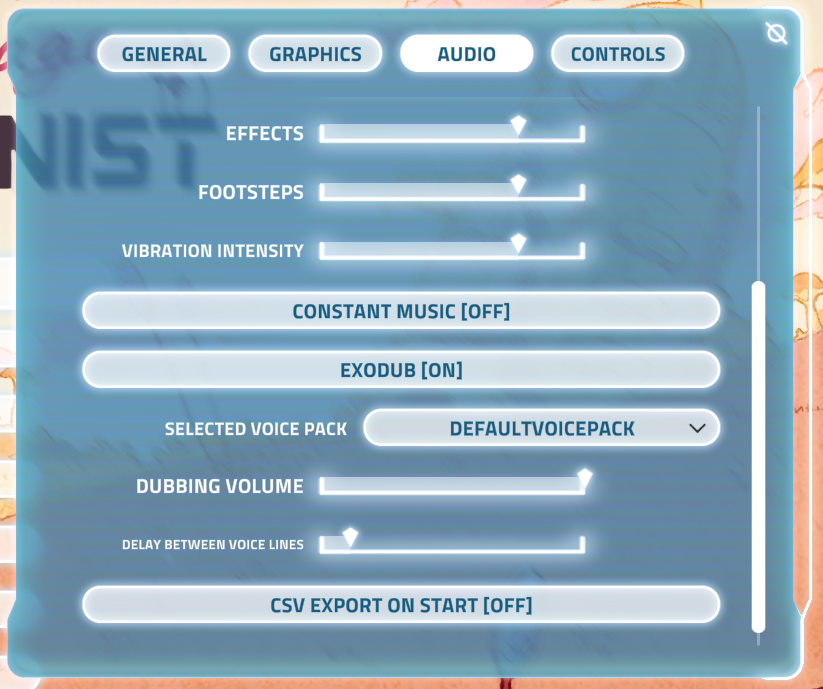
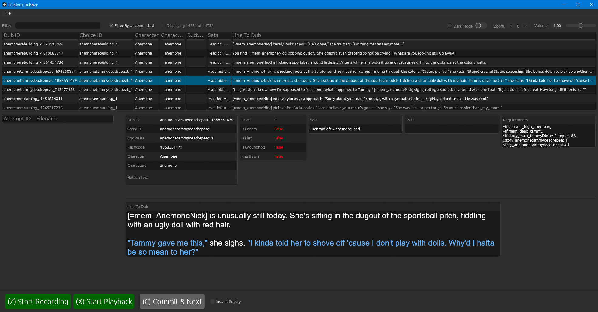
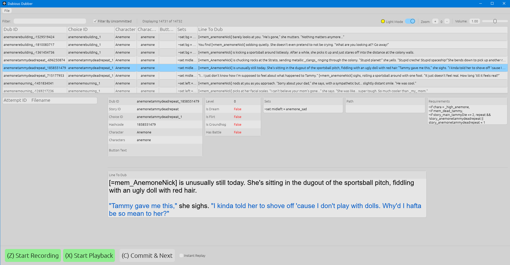

# Exodub

[License: GPL v3](https://www.gnu.org/licenses/gpl-3.0)

A Unity mod for [*I Was a Teenage Exocolonist*](https://store.steampowered.com/app/1148760/I_Was_a_Teenage_Exocolonist/) that allows custom voice dubbing for every storyline in the game. Releases include an example voicepack made with non-AI Microsoft Text-To-Speech.

> **Disclaimer:** Exodub is an unofficial, fan-made mod. It is not affiliated with or endorsed by Northway Games. *I Was A Teenage Exocolonist* and its assets belong to their respective owners. You must own a legitimate copy of the game to use this mod.

## Features

- Allows for custom audio files to be played for every possible permutation of story text that is displayed in game.
- Supports having a library of multiple voicepacks that can be swapped between in Settings > Audio
- Releases of this mod include an example voicepack made with non-AI Microsoft Text-To-Speech. So you can start listening right away.

## Requirements

- A legitimate copy of *The Exocolonist* (Steam / itch.io / other)
- Mod loader: **BepInEx** (version [5.4.23.5](https://github.com/BepInEx/BepInEx/releases/tag/v5.4.23.5) or newer)**

## Installation

1. Install **BepInEx** into your *Exocolonist* game folder by following [its instructions](https://bepinex.com/#installation).
2. Download the latest release from the [Releases page](https://github.com/BepInEx/BepInEx/releases).
3. Extract/copy `Exodub` into the Exocolonist root directory which should place the files correctly in `Exocolonist/BepInEx/plugins/ExoDub`.
4. Launch the game.
5. You can confirm that installation was successful if you see `ExoDub Is Active!` in the bottom right corner of the main menu.

## Usage

Once installed, all story text in game should automatically play audio from the default TTS voicepack. 

If you have installed an extra voicepack, go to Settings > Audio then scroll all the way down to the bottom to select the new voicepack.

## Configuration

All settings can be accessed from inside Exocolonist by going to Settings > Audio then scrolling all the way to the bottom.

| Option                | Default            | Description                                                                                          |
| --------------------- | ------------------ | ---------------------------------------------------------------------------------------------------- |
| `Enable`              | `true`             | Turns the Dubbing playback on or off                                                                 |
| `Dubbing Volume`      | `0.75`             | Controls volume of dubbing playback.                                                                 |
| `Selected Voice Pack` | `DefaultVoicePack` | Select which directory inside 'VoicePackLibrary' contains the voice pack audio files you want to use |
| `DelayBetweenLine`    | `0.3`              | Time in seconds between each voiceline in the same textbox being played                              |
| `GenerateCsvExport`   | `false`            | Create csv export on opening Exocolonist of all in-game text for creating new voice packs            |

Config file location: `Exocolonist\BepInEx\config\exodub.exocolonist.exodub.cfg`

## Contributing

Feel free to send pull requests to improve on this open source project. By contributing, you agree that your contributions will be licensed under the GPLv3. 

**Note: Please limit the use of AI for any code contributions.**

You can also help by helping create new properly voice acted voicepacks for Exodub to use and for people to enjoy. There is a custom made tool to help drastically simplify and speed up the process of creating a custom voicepack. So head on over to the [DubiousDubber](https://github.com/7h0m4s/DubiousDubber) repository *(named after contributer DubiousPhysics)* for a full tutorial on voicepack creation.

**Note: Please do not create voicepacks using AI Text-To-Speech voice generators. A lot of people put a lot of time and love into this game, so the least we can do is respect that level of effort.**

Custom Voicepack Creation Tool : https://github.com/7h0m4s/DubiousDubber

## Known Issues

- Exceptionally slow hard drives ***might*** experience a slight delay in voice lines starting to be played. As the audio files are loaded and unloaded live as needed, to keep memory usage to a minimum.

## F.A.Q.

- Why was this created?
  
  - The purpose of this mod was to 
    
    - Be a gift to several friends who have deeply enjoyed this game.
    
    - Practice Unity modding
    
    - Hopefully be a usefull accessibility mod to allow more players to experience this game

- Was this vibe coded with AI?
  
  - No. This mod has been written by hand. Feel free to review the messy git commits as proof.

- How does this mod work?
  
  - The mod collates all possible unique lines of text and creates an ID for each. Denoted by the Story Id of the story the line comes from and the hash number created from hashing the text itself. E.g. *anemonerepeat_-30790972*
  
  - These IDs and other related details can be exported as a CSV file to aid in the creation of the audio files. (CSV export can be enabled in Settings > Audio in-game)
  
  - Audio files are created as .ogg files in `Exocolonist\BepInEx\plugins\ExoDub\VoicePackLibrary\{VoicePackName}`
  
  - On game start-up, Exodub makes a list of which files are available
  
  - As Exocolonist is played, just as a new TextPanel is displayed on screen, ExoDub will quickly load and play the relevant audiofiles in parallel if they exist
  
  - The audio files are loaded and unloaded only as they are needed. To ensure no extra RAM memory is needed to play the game. As a full voicepack is over 1.5gb in size.

- Why is the default voicepack Microsoft TTS instead of proper voiceacting?
  
  - It was originally planned to properly voice act the entire game. A custom tool to do so was created and can be found at [DubiousDubber](https://github.com/7h0m4s/DubiousDubber). 
  
  - However *I Was a Teenage Exocolonist* has a rough wordcount of 580,000. The entire Lord of the Rings Trilogy is roughly 550,000 words.
  
  - So dubbing this game is a full project on it's own. So hopefully the community can try making a collaborative pack.

## Credits

- Northway Games, creators of *The Exocolonist*
- DubiousPhysics, modding and testing support 

## License

Exodub is free software: you can redistribute it and/or modify it under the terms of the **GNU General Public License, version 3**, as published by the Free Software Foundation.